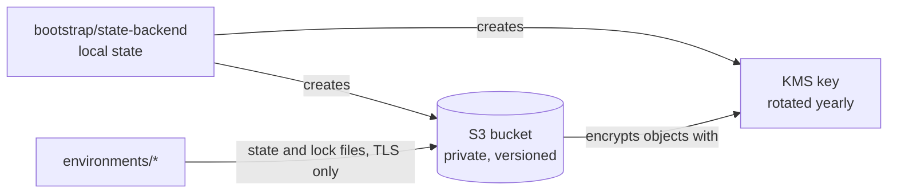

# State backend

Creates the S3 bucket that stores the Terraform state of every other stack. This configuration keeps its own state locally, because it cannot store it in a bucket that does not exist yet ([ADR-0001](../../docs/adr/0001-repository-layout.md)).



## Usage

From an up-to-date `main` branch ([ADR-0002](../../docs/adr/0002-plan-and-apply-from-a-workstation.md)):

1. Copy `local.auto.tfvars.example` to `local.auto.tfvars` and set your account ID.
2. Create the bucket:

   ```bash
   cd bootstrap/state-backend
   terraform init
   terraform plan -out=tfplan
   terraform apply tfplan
   ```

3. Write the backend configuration that every environment reads ([ADR-0003](../../docs/adr/0003-state-backend-configuration.md)):

   ```bash
   terraform output -raw backend_config > ../../backend.hcl
   ```

Back up `terraform.tfstate` from this directory outside the repository. If it is lost, the resources can be imported again ([runbook](../../docs/runbooks/state-backend.md)).

## Cost

About $1 per month, almost all of it for the KMS key. State files weigh a few hundred kilobytes, so storage and requests cost cents.

## Security

- Public access is blocked and ACLs are disabled: access is granted only through IAM policies.
- State files are encrypted with a customer managed KMS key. Reading them requires both S3 and KMS permissions, and CloudTrail logs every decryption.
- The bucket policy denies any request that does not use TLS.
- Versioning keeps previous states for 90 days, to recover from a corrupted or deleted state.
- The bucket cannot be destroyed while it holds state, unless `force_destroy` is enabled.
- Server access logging is disabled (Trivy AWS-0089, low severity). It would require a second bucket. CloudTrail data events are the better option when object-level auditing is needed.

<!-- BEGIN_TF_DOCS -->
### Requirements

| Name | Version |
| ---- | ------- |
| terraform | >= 1.17 |
| aws | ~> 6.73 |

### Providers

| Name | Version |
| ---- | ------- |
| aws | ~> 6.73 |

### Resources

| Name | Type |
| ---- | ---- |
| [aws_kms_alias.state](https://registry.terraform.io/providers/hashicorp/aws/latest/docs/resources/kms_alias) | resource |
| [aws_kms_key.state](https://registry.terraform.io/providers/hashicorp/aws/latest/docs/resources/kms_key) | resource |
| [aws_s3_bucket.state](https://registry.terraform.io/providers/hashicorp/aws/latest/docs/resources/s3_bucket) | resource |
| [aws_s3_bucket_lifecycle_configuration.state](https://registry.terraform.io/providers/hashicorp/aws/latest/docs/resources/s3_bucket_lifecycle_configuration) | resource |
| [aws_s3_bucket_ownership_controls.state](https://registry.terraform.io/providers/hashicorp/aws/latest/docs/resources/s3_bucket_ownership_controls) | resource |
| [aws_s3_bucket_policy.state](https://registry.terraform.io/providers/hashicorp/aws/latest/docs/resources/s3_bucket_policy) | resource |
| [aws_s3_bucket_public_access_block.state](https://registry.terraform.io/providers/hashicorp/aws/latest/docs/resources/s3_bucket_public_access_block) | resource |
| [aws_s3_bucket_server_side_encryption_configuration.state](https://registry.terraform.io/providers/hashicorp/aws/latest/docs/resources/s3_bucket_server_side_encryption_configuration) | resource |
| [aws_s3_bucket_versioning.state](https://registry.terraform.io/providers/hashicorp/aws/latest/docs/resources/s3_bucket_versioning) | resource |

### Inputs

| Name | Description | Type | Default | Required |
| ---- | ----------- | ---- | ------- | :------: |
| account\_id | ID of the AWS account that holds the state. Set it in local.auto.tfvars, which is not committed. | `string` | n/a | yes |
| force\_destroy | Allow destroy to delete the bucket while it still contains state files. Enable only to tear down a test deployment. | `bool` | `false` | no |
| kms\_deletion\_window\_in\_days | Waiting period, in days, before the KMS key is deleted after a destroy. | `number` | `30` | no |
| name | Prefix of every resource name. | `string` | `"ats"` | no |
| noncurrent\_version\_retention\_days | Number of days a previous version of a state file is kept before it is deleted. | `number` | `90` | no |
| region | Region of the state bucket. | `string` | `"us-east-1"` | no |

### Outputs

| Name | Description |
| ---- | ----------- |
| backend\_config | Partial backend configuration for environments. Save it as backend.hcl at the repository root, which is not committed. |
| bucket\_arn | ARN of the state bucket. |
| bucket\_name | Name of the state bucket. |
| kms\_key\_arn | ARN of the KMS key that encrypts state files. |
<!-- END_TF_DOCS -->
