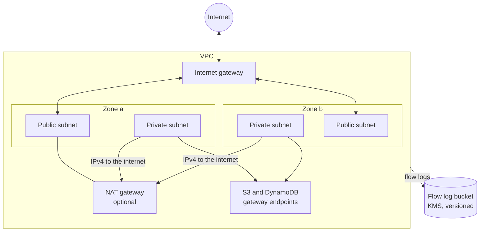

# Network

Multi-AZ VPC with public and private subnets, optional NAT gateways and IPv6, VPC endpoints and encrypted flow logs.



## Usage

```hcl
module "network" {
  source = "../../modules/network"

  name               = "ats-dev"
  availability_zones = ["us-east-1a", "us-east-1b"]
  nat_gateway_mode   = "none"
}
```

Runnable configurations: [examples/basic](examples/basic) and [examples/complete](examples/complete).

## Subnet layout

Each subnet is a sixteenth of the VPC. Public subnets take blocks 0 to 3 and private subnets blocks 8 to 11, so up to four zones fit without renumbering. With the default `10.0.0.0/16`:

| Zone | Public | Private |
|---|---|---|
| 1st | `10.0.0.0/20` | `10.0.128.0/20` |
| 2nd | `10.0.16.0/20` | `10.0.144.0/20` |
| 3rd | `10.0.32.0/20` | `10.0.160.0/20` |

With `enable_ipv6`, each subnet also gets the `/64` at the same position in the VPC's `/56`.

Outbound access from private subnets depends on `nat_gateway_mode` ([ADR-0004](../../docs/adr/0004-nat-gateway-strategy.md)). S3 and DynamoDB are always reachable through gateway endpoints.

## Cost

| Item | Price in `us-east-1` | Default |
|---|---|---|
| VPC, subnets, route tables, internet gateway, gateway endpoints | free | on |
| NAT gateway | $0.045/h, plus $0.005/h for its public IPv4 address and $0.045/GB processed | off |
| Interface endpoint | $0.01/h per zone, plus $0.01/GB | none |
| Egress-only internet gateway | free, data transfer only | off |
| Flow logs | $1/month for the KMS key, plus delivery and storage per GB | on |

With the defaults, an idle network costs about $1 per month.

## Security

- The default security group is taken over and left without rules, so a resource launched without an explicit group gets no network access.
- Public subnets do not assign public IPv4 addresses automatically.
- Interface endpoints accept HTTPS from the VPC only.
- Flow logs record accepted and rejected traffic ([ADR-0005](../../docs/adr/0005-flow-logs-to-s3.md)). Their bucket is private, versioned, encrypted with a dedicated KMS key and reachable over TLS only, and only the log delivery service acting for this account can write to it.
- The flow log bucket does not record its own access logs (Trivy AWS-0089, low severity): it would need yet another bucket.
- Network ACLs keep their default allow-all rules. Security groups are the access control layer.

<!-- BEGIN_TF_DOCS -->
### Requirements

| Name | Version |
| ---- | ------- |
| terraform | >= 1.17 |
| aws | >= 6.0 |

### Providers

| Name | Version |
| ---- | ------- |
| aws | >= 6.0 |

### Resources

| Name | Type |
| ---- | ---- |
| [aws_default_security_group.this](https://registry.terraform.io/providers/hashicorp/aws/latest/docs/resources/default_security_group) | resource |
| [aws_egress_only_internet_gateway.this](https://registry.terraform.io/providers/hashicorp/aws/latest/docs/resources/egress_only_internet_gateway) | resource |
| [aws_eip.nat](https://registry.terraform.io/providers/hashicorp/aws/latest/docs/resources/eip) | resource |
| [aws_flow_log.this](https://registry.terraform.io/providers/hashicorp/aws/latest/docs/resources/flow_log) | resource |
| [aws_internet_gateway.this](https://registry.terraform.io/providers/hashicorp/aws/latest/docs/resources/internet_gateway) | resource |
| [aws_kms_alias.flow_logs](https://registry.terraform.io/providers/hashicorp/aws/latest/docs/resources/kms_alias) | resource |
| [aws_kms_key.flow_logs](https://registry.terraform.io/providers/hashicorp/aws/latest/docs/resources/kms_key) | resource |
| [aws_nat_gateway.this](https://registry.terraform.io/providers/hashicorp/aws/latest/docs/resources/nat_gateway) | resource |
| [aws_route.private_ipv6_egress](https://registry.terraform.io/providers/hashicorp/aws/latest/docs/resources/route) | resource |
| [aws_route.private_nat](https://registry.terraform.io/providers/hashicorp/aws/latest/docs/resources/route) | resource |
| [aws_route.public_internet_ipv4](https://registry.terraform.io/providers/hashicorp/aws/latest/docs/resources/route) | resource |
| [aws_route.public_internet_ipv6](https://registry.terraform.io/providers/hashicorp/aws/latest/docs/resources/route) | resource |
| [aws_route_table.private](https://registry.terraform.io/providers/hashicorp/aws/latest/docs/resources/route_table) | resource |
| [aws_route_table.public](https://registry.terraform.io/providers/hashicorp/aws/latest/docs/resources/route_table) | resource |
| [aws_route_table_association.private](https://registry.terraform.io/providers/hashicorp/aws/latest/docs/resources/route_table_association) | resource |
| [aws_route_table_association.public](https://registry.terraform.io/providers/hashicorp/aws/latest/docs/resources/route_table_association) | resource |
| [aws_s3_bucket.flow_logs](https://registry.terraform.io/providers/hashicorp/aws/latest/docs/resources/s3_bucket) | resource |
| [aws_s3_bucket_lifecycle_configuration.flow_logs](https://registry.terraform.io/providers/hashicorp/aws/latest/docs/resources/s3_bucket_lifecycle_configuration) | resource |
| [aws_s3_bucket_ownership_controls.flow_logs](https://registry.terraform.io/providers/hashicorp/aws/latest/docs/resources/s3_bucket_ownership_controls) | resource |
| [aws_s3_bucket_policy.flow_logs](https://registry.terraform.io/providers/hashicorp/aws/latest/docs/resources/s3_bucket_policy) | resource |
| [aws_s3_bucket_public_access_block.flow_logs](https://registry.terraform.io/providers/hashicorp/aws/latest/docs/resources/s3_bucket_public_access_block) | resource |
| [aws_s3_bucket_server_side_encryption_configuration.flow_logs](https://registry.terraform.io/providers/hashicorp/aws/latest/docs/resources/s3_bucket_server_side_encryption_configuration) | resource |
| [aws_s3_bucket_versioning.flow_logs](https://registry.terraform.io/providers/hashicorp/aws/latest/docs/resources/s3_bucket_versioning) | resource |
| [aws_security_group.endpoints](https://registry.terraform.io/providers/hashicorp/aws/latest/docs/resources/security_group) | resource |
| [aws_subnet.private](https://registry.terraform.io/providers/hashicorp/aws/latest/docs/resources/subnet) | resource |
| [aws_subnet.public](https://registry.terraform.io/providers/hashicorp/aws/latest/docs/resources/subnet) | resource |
| [aws_vpc.this](https://registry.terraform.io/providers/hashicorp/aws/latest/docs/resources/vpc) | resource |
| [aws_vpc_endpoint.gateway](https://registry.terraform.io/providers/hashicorp/aws/latest/docs/resources/vpc_endpoint) | resource |
| [aws_vpc_endpoint.interface](https://registry.terraform.io/providers/hashicorp/aws/latest/docs/resources/vpc_endpoint) | resource |
| [aws_vpc_security_group_ingress_rule.endpoints_https](https://registry.terraform.io/providers/hashicorp/aws/latest/docs/resources/vpc_security_group_ingress_rule) | resource |
| [aws_caller_identity.current](https://registry.terraform.io/providers/hashicorp/aws/latest/docs/data-sources/caller_identity) | data source |
| [aws_partition.current](https://registry.terraform.io/providers/hashicorp/aws/latest/docs/data-sources/partition) | data source |
| [aws_region.current](https://registry.terraform.io/providers/hashicorp/aws/latest/docs/data-sources/region) | data source |

### Inputs

| Name | Description | Type | Default | Required |
| ---- | ----------- | ---- | ------- | :------: |
| availability\_zones | Availability zones that receive one public and one private subnet each, for example ["us-east-1a", "us-east-1b"]. | `list(string)` | n/a | yes |
| name | Prefix of every resource name, for example ats-dev. | `string` | n/a | yes |
| cidr\_block | IPv4 CIDR block of the VPC, between /16 and /20. Each subnet takes a sixteenth of it. | `string` | `"10.0.0.0/16"` | no |
| enable\_ipv6 | Assign an Amazon-provided IPv6 block to the VPC and a /64 to every subnet. Private subnets reach the internet over IPv6 through an egress-only gateway, which has no hourly charge. | `bool` | `false` | no |
| flow\_logs\_enabled | Record the metadata of all traffic in the VPC to a dedicated, encrypted S3 bucket. See ADR-0005. | `bool` | `true` | no |
| flow\_logs\_force\_destroy | Allow destroy to delete the flow log bucket while it still contains logs. Enable only for disposable environments. | `bool` | `false` | no |
| flow\_logs\_retention\_days | Number of days flow log files are kept. | `number` | `30` | no |
| gateway\_endpoints | Services reached from private subnets through gateway endpoints, which are free. | `set(string)` | ```[ "s3", "dynamodb" ]``` | no |
| interface\_endpoints | Services reached from private subnets through interface endpoints, for example ["ssm", "logs"]. Each one costs about $0.01 per hour per availability zone. | `set(string)` | `[]` | no |
| kms\_deletion\_window\_in\_days | Waiting period, in days, before the flow log KMS key is deleted after a destroy. | `number` | `30` | no |
| nat\_gateway\_mode | Outbound IPv4 internet access for private subnets: none, single (one gateway shared by every zone) or per\_az (one gateway in each zone). See ADR-0004. | `string` | `"none"` | no |
| tags | Tags added to every resource, on top of the provider default tags. | `map(string)` | `{}` | no |

### Outputs

| Name | Description |
| ---- | ----------- |
| endpoints\_security\_group\_id | ID of the security group attached to the interface endpoints. Null when interface\_endpoints is empty. |
| flow\_logs\_bucket\_name | Name of the bucket that receives the flow logs. Null when flow\_logs\_enabled is false. |
| nat\_gateway\_public\_ips | Public IPv4 addresses of the NAT gateways. Empty when nat\_gateway\_mode is none. |
| private\_route\_table\_ids | IDs of the private route tables, one per zone, in the order of availability\_zones. |
| private\_subnet\_ids | IDs of the private subnets, in the order of availability\_zones. |
| public\_route\_table\_id | ID of the route table shared by the public subnets. |
| public\_subnet\_ids | IDs of the public subnets, in the order of availability\_zones. |
| vpc\_cidr\_block | IPv4 CIDR block of the VPC. |
| vpc\_id | ID of the VPC. |
| vpc\_ipv6\_cidr\_block | IPv6 CIDR block of the VPC. Null when enable\_ipv6 is false. |
<!-- END_TF_DOCS -->
